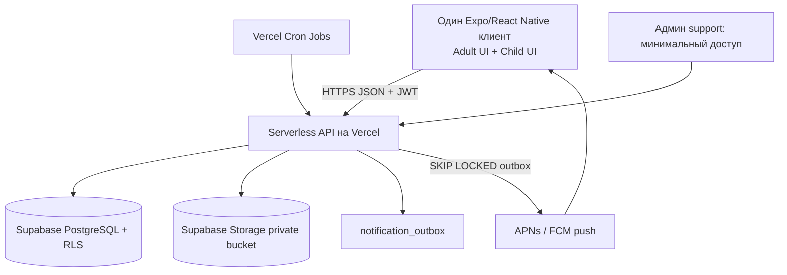

# Архитектура и стек v0.1

## Почему не Bubble в MVP
Bubble можно использовать для прототипа, но для нового мобильного продукта с кастомными разрешениями, безопасным child pairing, приватными фото, офлайн-состояниями и воспроизводимыми тестами агента **предлагается** нативный TypeScript-стек. Это архитектурное допущение P01, а не дополнительный ответ пользователя.

## Схема



## Мобильный клиент
- `React Native + Expo SDK` (согласовать актуальные совместимые версии по official docs при `bootstrap`); `Expo Router`; `TypeScript strict`.
- Состояние данных: TanStack Query, query keys с `familyId/childId`, очистка кэша при logout/смене семьи/смене ребёнка.
- Формы: React Hook Form + Zod или аналог после одного ADR; локализация `i18next`/`react-i18next` (переводы по ключам, placeholder и склонения).
- API: один typed fetch-client на базе сгенерированного OpenAPI контракта; токен в OS SecureStore/Keychain, никогда в AsyncStorage.
- Фото: системный photo picker/camera с явным согласием; компрессия и удаление EXIF перед загрузкой.
- Для MVP только сетевой режим с понятным retry и optimistic UI **только** на безопасных чтениях; критические операции показывать подтверждённый сервером статус.

## Backend
- Serverless API на **Vercel** (TypeScript, OpenAPI + схемная валидация); модули `auth/family/children/diary/tasks/points/shop/wishes/mood/achievements/notifications/consent` в `apps/api` деплоятся как serverless functions.
- `Supabase PostgreSQL` как единственный источник истины, миграции в Git (Supabase migrations, версию CLI закрепить в lockfile). Вся многотабличная бизнес-логика выполняется в DB transaction.
- Подключение из Vercel — только через pooled connection string (Supabase Pooler); service-role/DB ключи живут в Vercel environment variables, никогда не попадают в мобильный клиент.
- **RLS обязателен** на всех таблицах с семейными/детскими данными как второй слой защиты; server-side authorization в API остаётся первичным.
- `Redis` не требуется в начале. Outbox + Vercel Cron с Postgres `FOR UPDATE SKIP LOCKED` и планировщиком достаточны для MVP; масштабировать позже по метрикам.
- Хранение файлов: **Supabase Storage private buckets**; серверная авторизация до выдачи краткосрочного signed URL, проверка MIME/размера, запрет публичного доступа, scrub EXIF.
- Письма взрослым и push: нейтральные payload'ы без чувствительных данных; выбор e-mail-провайдера — через ADR. При выборе регионов провайдеров учитывать требования целевого рынка (например GDPR data residency для ЕС).
- Разделить dev/test/prod проекты Supabase и ключи Vercel; бэкапы с проверенными процедурами восстановления.

## Идентификация и роли
- Adult имеет email/password и email verification, может состоять в нескольких семьях. `family_members.permission_profile` задаёт серверные полномочия; `relation_label` — только отображение.
- Child — отдельный `children` профиль с безопасной device session. Ребёнок не знает постоянный пароль; 6-значный код только для первичного связывания с устройством, проверяется на сервере по rate limit и expiry; выдача сессии возможна только после отдельного подтверждения конкретного устройства родителем.
- Сроки access JWT, refresh rotation, блокировка отозванных устройств; сервер проверяет идентичность **каждого** запроса.
- Отказы в доступе — `403`, отсутствие в семье — `404` без раскрытия существования чужих записей.

## Мультиарендность
- Every user-owned record includes `family_id` where applicable. Запрос всегда начинается с `requireFamilyScope(actor, familyId)` и затем `requireChildScope(actor, childId)`.
- Ссылки между записями другого семейного аккаунта не могут быть использованы; сервисные транзакции проверяют принадлежность всех связанных ID.
- Клиентская проверка роли нужна только для удобства UX, **не** для безопасности.
- В Supabase включён RLS на всех таблицах с семейными/детскими данными как дополнительный слой; но серверная авторизация (`requireFamilyScope`/`requireChildScope`) остаётся обязательной — клиент никогда не подключается к БД напрямую.

## Структура монорепозитория

```text
family-app/
  AGENTS.md
  apps/mobile/
    src/app/(auth)/
    src/app/(adult)/
    src/app/(child)/
    src/components/
    src/features/{family,diary,tasks,shop,wishes,mood,achievements}/
    src/i18n/{ru,en}.json
    src/lib/{api,auth,query,errors}/
  apps/api/                        # serverless API (Vercel)
    src/modules/{auth,families,children,diary,tasks,points,shop,wishes,mood,achievements,notifications,consent}/
    src/common/{guards,policies,dto,errors,logging}/
    supabase/migrations/
    test/{integration,e2e}/
  packages/jobs/                   # cron/scheduled handlers for Vercel
    src/jobs/{task-recurrence,mood-reminders,talk-reminders,push-outbox}/
  packages/contracts/          # OpenAPI generated client/types and schemas
  packages/config/             # eslint, prettier, tsconfig
  docs/
  .github/workflows/
```

## Deployment
- `main` => deploy на Vercel (prod project) после merge, тестов, security gate и ручного approve миграций; PR preview-деплои => staging project Supabase/Vercel. Локальный веб не поддерживается: веб-версия собирается и работает только на Vercel.
- CI: format/typecheck/lint/unit/integration tests, dependency scan, API contract checks, migration validation (в т.ч. schema-test на in-process Postgres), build Android+iOS на соответствующих runners/EAS.
- В CI не помещать реальные персональные данные/ключи; seed только синтетические; Preview-деплои подключаются только к staging Supabase, никогда к prod.
- Supabase migrations фиксировать в Git, применять через CI job согласно **закреплённой версии CLI** (см. официальную документацию в README). Деструктивные миграции через expand/backfill/contract.

## Архитектурные решения, которые запрещено менять молча
1. Все постоянные данные — в Supabase (PostgreSQL + Storage), API — на Vercel; другой способ хранения — только через ADR.
2. Нет прямого подключения клиентского приложения к БД; RLS — второй слой, не замена API-авторизации.
3. Нет хранения фото в публичном URL.
4. Нет child-wide PIN вечно действующего для входа.
5. Нет начисления баллов на клиенте.
6. Нет ИИ-анализа эмоций в MVP.
7. Лента не подменяет живое общение автоматическими отчётами.
