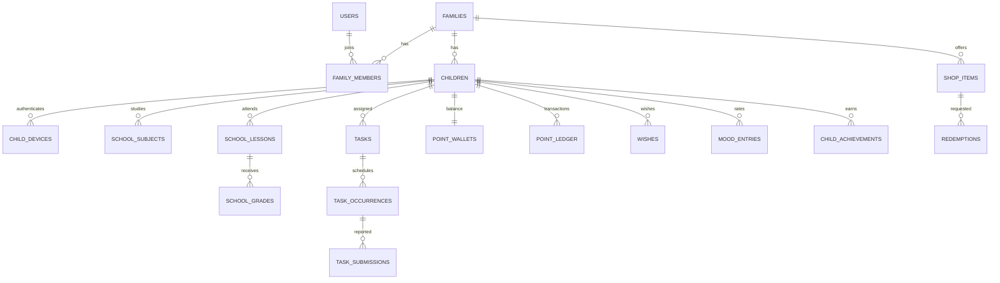

# Database Design v0.1 — PostgreSQL

`../db/001_schema_draft.sql` — предварительная физическая схема. Описанная здесь структура — **проект**, а не утверждение, что все миграции и проверки уже реализованы.

## ERD (укрупнённый)

## Таблицы и назначения

| Группа | Таблицы | Ключевые поля |
|---|---|---|
| Identity | `users`, `adult_sessions`, `families`, `family_members`, `children`, `child_pair_codes`, `child_devices`, `family_invites` | password_hash, email, owner, family_id, role, relation_label, expires_at, token_hash |
| Дневник | `school_subjects`, `weekly_lessons`, `school_lessons`, `school_grades`, `teacher_remarks`, `diary_audit` | weekday, lesson_slot, date, grade_1_to_5, edited_by, changed_at |
| Задания | `tasks`, `task_occurrences`, `task_submissions`, `media_assets`, `submission_media` | points, recurrence, due_date, status, submitted_at, review_status |
| Экономика | `point_wallets`, `point_ledger`, `shop_items`, `redemptions` | balance, delta, idempotency_key, price, status |
| Личное | `wishes`, `mood_entries`, `achievement_defs`, `child_achievements` | title, URL, score, emoji, comment_encrypted, badge_key |
| Сервис | `user_devices`, `notifications`, `notification_outbox`, `consent_records`, `deletion_requests`, `audit_events` | recipient, type, schedule, delivery, actor, consent_version |

## Главные инварианты

1. Любая запись принадлежит одному `family_id`. Сервис сверяет владельца каждой вложенной сущности, не только корневой ID из URL.
2. `school_grades.score BETWEEN 1 AND 5`. Ребёнку разрешён `INSERT` только в собственный дневник. `UPDATE`/`DELETE` оценок только взрослому с разрешением. Удаление через `deleted_at`, событие в `diary_audit`.
3. Внешние `teacher_remarks` — записи пользователя, а не подтверждённые школой сведения; нельзя отображать как официальный документ.
4. `task_occurrences` уникальны по `(task_id, scheduled_date)`. Worker может запускаться повторно без дубликатов.
5. У каждой `task_submissions` неизменный отчёт (фото + текст). В случае доработки создаётся **новый** отчёт, предыдущий сохраняется.
6. Одобрить occurrence можно только раз; `point_ledger.idempotency_key` уникален. Баланс не отрицательный.
7. Баллы в магазине списываются/резервируются транзакционно при заявке; возврат ровно один раз при отказе; сумма не может стать отрицательной.
8. `mood_entries` уникальны по `(child_id, local_date)`. Child видит свой комментарий. Adult API никогда не сериализует его.
9. Связанные файлы закрыты и живут в private bucket Supabase Storage; для API используются короткоживущие подписанные ссылки **после проверки разрешений**.
10. Child активируется только неиспользованным, действующим `child_pair_code` и **после approval `child_pair_request` взрослым**, с защитой от массовых переборов.
11. Все системные временные метки хранятся в UTC `timestamptz`, пользовательская дата настроения — `DATE` в локальной timezone семьи.
12. Hard delete юридически предусмотренных данных координируется с Supabase Storage, сессиями, уведомлениями и резервными копиями по утверждённой политике retention.

## Транзакции, обязательные в коде

### Одобрение задания
`BEGIN` → проверить право взрослого и семью → lock occurrence → убедиться, что `submitted` → пометить approved/completed → вставить `point_ledger` с ключом `task-approved:<occurrenceId>` → обновить `point_wallets` → вставить `notification_outbox` → `COMMIT`. При повторном запросе вернуть существующий результат, не выдавать баллы снова.

### Обмен баллов на товар
`BEGIN` → lock wallet `SELECT ... FOR UPDATE` → проверить активность товара и цену → проверить доступный баланс → создать redemption `requested` + запись `point_ledger` `-price` → уменьшить wallet → outbox → `COMMIT`.

### Отказ от обмена
`BEGIN` → lock redemption → проверить `requested/approved` и право взрослого → перевести в `declined`, вставить refund `+price` с уникальным ключом `redeem-refund:<id>` → обновить баланс → `COMMIT`.

### Обновление оценки взрослым
`BEGIN` → проверить child и family → сохранить before/after в diary audit → обновить строку `school_grades`, actor и timestamp → `COMMIT`.

## Индексы и производительность
- `family_members(user_id, family_id)` и `children(family_id)`.
- `school_lessons(child_id, lesson_date, lesson_slot)`; `school_grades(child_id, scored_at, subject_id)` с фильтром `deleted_at IS NULL`.
- `tasks(child_id, active)` и `task_occurrences(child_id, scheduled_date, status)`.
- `point_ledger(child_id, created_at)` + уникальный `idempotency_key`.
- `mood_entries(child_id, local_date)` UNIQUE.
- `notification_outbox(status, run_at)` для worker и дедупликации.

## Аудит и приватность
- `diary_audit` только для оценок/важных исправлений, actor + метаданные и до/после; не публиковать child.
- `audit_events` для смены ролей, удаления, привязки устройств, начислений, подозрительного доступа. Не включать пароли, PIN, токены, расшифрованные mood comments или фото.
- Взрослый по умолчанию получает score-only агрегаты эмоций, не `comment_ciphertext`; расшифровка комментария доступна только детскому сервису.

## TBD extension points
- `goal_definitions`, `goal_progress`, `goal_rules`, `goal_evidence` проектировать после TBD-GOALS.
- `achievement_defs.rule_json` сейчас nullable; автоусловия выключены, генерация значков отдельно.
- Гибкие семейные permissions можно добавить в отдельную таблицу `member_permissions` после UX/правового решения; на MVP фиксированные server-side профили.
